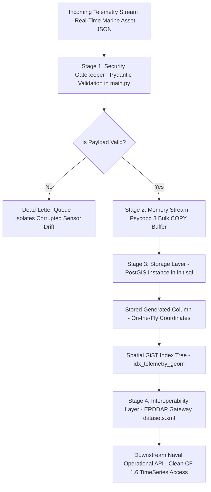

# ARCHITECTURAL BRIEF: METOC ELT TELEMETRY PIPELINE
**Prepared by:** Dylan Nixon  
**Target Architecture:** CNMOC Data Dissemination SBIR Project  
**Status:** Functional Prototype Delivered & Verified Natively via CI/CD

##  SYSTEM OPERATIONAL WALKTHROUGH

1. **Stage 1: Risk Mitigation Boundary (Data Ingestion)**
Data enters the pipeline as raw, real-time JSON strings directly from active marine assets. This layer acts as a primary defense gate. Before any data can touch permanent disk storage, an interlocking Python framework inspects every field to guarantee structural alignment.

2. **Stage 2: Core Resiliency & The Dead-Letter Queue (DLQ)**
If a buoy experiences hardware damage or GPS sensor drift, it will emit impossible tracking coordinates. Instead of allowing that corrupt payload to crash the backend services or pollute charts, the pipeline instantly shunts the anomaly into a Dead-Letter Queue (DLQ) for engineering analysis. The rest of the fleet continues streaming with zero system downtime.

3. **Stage 3: High-Velocity Database Storage Injection**
Valid data frames completely bypass traditional, slow row-by-row SQL database structures. Telemetry streams are serialized directly into database RAM via PostgreSQL's native streaming channel at near-disk speeds. Once inside, the PostGIS engine automatically derives physical Earth coordinates on-the-fly, locking them into a specialized GiST search tree index.

4. **Stage 4: Mission-Ready Interoperability & Client Access**
Finally, the ERDDAP Dissemination Gateway maps the structured spatial database views directly into strict federal and military science metadata schemas (CF-1.6 / ACDD-1.3). This architecture guarantees that when a downstream tactical asset queries a geographic bounding box, the database performs a rapid index scan rather than a slow table scan, cleanly satisfying CNMOC’s 15-minute data freshness SLA.

---
**Deployment Footprint:** Fully containerized via Docker Compose. Continually tested and verified passing on every code modification via an automated GitHub Actions CI/CD pipeline.
