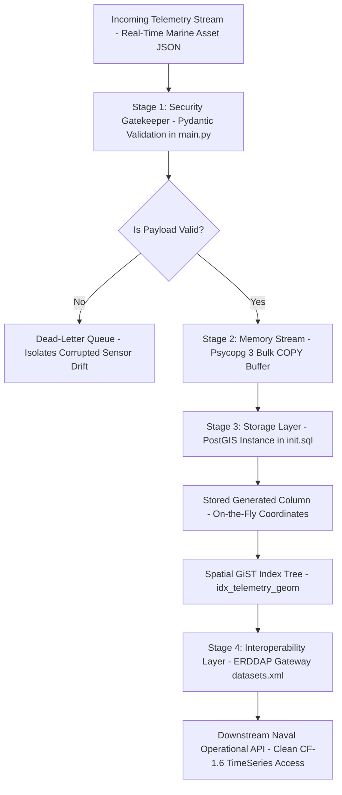

# ARCHITECTURAL BRIEF: METOC ELT TELEMETRY PIPELINE
**Prepared by:** Dylan Nixon  
**Target Architecture:** CNMOC Data Dissemination SBIR Project  
**Status:** Functional Prototype Delivered & Verified Natively via CI/CD



##  SYSTEM OPERATIONAL WALKTHROUGH

1. **Stage 1: Risk Mitigation Boundary (Data Ingestion)**
Data enters the pipeline as raw, real-time JSON strings directly from active marine assets. This layer acts as a primary defense gate. Before any data can touch permanent disk storage, an interlocking Python framework inspects every field to guarantee structural alignment.

2. **Stage 2: Core Resiliency & The Dead-Letter Queue (DLQ)**
If a buoy experiences hardware damage or GPS sensor drift, it will emit impossible tracking coordinates. Instead of allowing that corrupt payload to crash the backend services or pollute charts, the pipeline instantly shunts the anomaly into a Dead-Letter Queue (DLQ) for engineering analysis. The rest of the fleet continues streaming with zero system downtime.

3. **Stage 3: High-Velocity Database Storage Injection**
Valid data frames completely bypass traditional, slow row-by-row SQL database structures. Telemetry streams are serialized directly into database RAM via PostgreSQL's native streaming channel at near-disk speeds. Once inside, the PostGIS engine automatically derives physical Earth coordinates on-the-fly, locking them into a specialized GiST search tree index.

4. **Stage 4: Mission-Ready Interoperability & Client Access**
Finally, the ERDDAP Dissemination Gateway maps the structured spatial database views directly into strict federal and military science metadata schemas (CF-1.6 / ACDD-1.3). This architecture guarantees that when a downstream tactical asset queries a geographic bounding box, the database performs a rapid index scan rather than a slow table scan, cleanly satisfying CNMOC’s 15-minute data freshness SLA.

---
**Deployment Footprint:** Fully containerized via Docker Compose. Continually tested and verified passing on every code modification via an automated GitHub Actions CI/CD pipeline.
# CNMOC Data Dissemination SBIR Project: High-Velocity ELT Pipeline

An optimized, real-time data engineering pipeline designed to ingest, validate, transform, and store high-velocity marine telemetry streams, delivering data via a CF-1.6 compliant ERDDAP interoperability layer. 

This architecture was built from scratch to demonstrate production-grade data engineering strategies engineered directly against the Commander, Naval Meteorology and Oceanography Command (CNMOC) technical infrastructure.

## Blueprint

1. **Velocity Layer (Ingestion):** Absorbs real-time JSON packets asynchronously from deployed marine assets into an event stream framework.
2. **Compute Layer (Validation & Transformation):** Bypasses Python’s single-threaded CPU limits by utilizing **Polars' multi-threaded Rust execution engine** and lazy evaluation.
3. **Security Gatekeeper (Schema Enforcement):** Enforces strict runtime data boundaries using **Pydantic** to block malformed inputs or impossible coordinates (e.g., GPS drift) before database contact.
4. **Storage Layer (Bulk Ingestion):** Maximizes write performance using `psycopg` to stream byte buffers directly into memory using the native **PostgreSQL `COPY` protocol**, eliminating slow row-by-row `INSERT` statement overhead.
5. **Interoperability Layer (Data Delivery):** Standardizes PostGIS geospatial records into a **CF-1.6 and ACDD-1.3 compliant TimeSeries format** via ERDDAP (`datasets.xml`) for instant downstream operational access.

## Key Engineering Decisions

* **Polars Lazy Evaluation:** Built-in optimization maps an in-memory execution plan before data execution occurs, squeezing maximum performance out of parallel multi-core architectures.
* **Stream-to-Memory Bulk Writing:** Serializes data straight to an unheadered CSV byte stream (`BytesIO`), feeding the PostgreSQL storage engine at near-disk speeds.
* **Enterprise Security First Mindset:** Designed explicitly to support DISA STIG guidelines by validating all inputs at the data boundary layer, isolating read-only ERDDAP users, and maintaining transactional database integrity via automatic context managers.

## Stack & Dependencies
* **Core Processing:** Python 3.11+, Polars, Pydantic v2
* **Database Infrastructure:** PostgreSQL, PostGIS, Psycopg 3
* **Dissemination Engine:** ERDDAP (DataHub/Amundsen adjacent mapping formats)
 
## Database Schema & Spatial Optimization
The pipeline assumes a backing PostGIS-enabled PostgreSQL instance configured with the schema provided in `init.sql`.

### Zero-Overhead Spatial Indexing
To maximize bulk insertion throughput, spatial geometries are not computed in application code or via post-ingestion sequential updates. Instead, the database uses a **Stored Generated Column** to automatically derive coordinates during the psycopg `COPY` stream:

```sql
geom GEOMETRY(Point, 4326) GENERATED ALWAYS AS (
    ST_SetSRID(ST_MakePoint(longitude, latitude), 4326)
) STORED;
```

A **GiST (Generalized Search Tree) Index** is explicitly declared on the computed `geom` column (`idx_telemetry_geom`). This ensures that downstream geographic polygon or bounding-box requests sent by the ERDDAP interoperability layer execute via index scans rather than expensive, slow sequential table scans.
